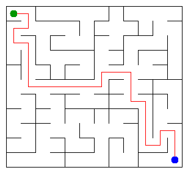

# Assignment 3. Maze Escape

Student ID: **252119**  
Name: **Nataliyev Daniyar**  
Group: **SE-2536**  
Maze size: **11 x 12** (132 cells, 241 inner walls)

## Run

Requires a JDK 17 or newer. Run from this folder:

```powershell
javac -d out src/*.java
java -cp out Main
java tools/Check.java
```

Open `output/maze.html` in a browser to explore the maze. To reproduce the personal inputs:

```powershell
java tools/MakeVariant.java 252119 data
```

## Program output

Actual output on the personal data:

```text
Broken: 131
Kept: 110
Last broken wall: 204
MST cost: 39930
Heaviest broken wall: 824
Path length: 27
DFS visited: 82
Dead ends: 37
Zones: 132
Largest zone: 1
Is DAG: 1
Flow stages: 15
Fastest route cost: 8
```

The last broken wall is wall record 204 (counting wall records from 1, excluding the header).



## Questions

**Mission 0. What do find and union do, and what makes them fast?**  
`find(x)` returns the root of x's set. `union(a, b)` joins different sets and returns true, or returns false if they already have the same root. Union by size attaches the smaller tree under the larger one; path compression makes every node on a searched path point directly to the root.

**Mission 1. Why is Broken R*C - 1, and Kept (R-1)*(C-1)?**  
Initially every cell is a separate component, and each accepted wall reduces the component count by one. The grid is connected, so exactly R*C - 1 walls are removed to obtain one connected tree without cycles. There are R*(C-1) + (R-1)*C inner walls in total; subtracting R*C - 1 gives (R-1)*(C-1): here 131 broken and 110 kept.

**Mission 2. MST costs and why they agree.**  
Kruskal and Prim both give **39930**. Kruskal considers edges from cheapest to most expensive and rejects cycles; Prim repeatedly picks the cheapest edge crossing from its tree to an unvisited cell. Both construct an MST, and all wall costs are distinct here, so the MST itself is unique too.

**Mission 3. Why one path, and how is stack overflow avoided?**  
Mission 1 builds a connected graph with no cycles, which is a tree. Two different simple paths between the same cells would form a cycle, so the path is unique. DFS uses arrays for its stack and next-direction state instead of recursive calls, preserving the required up, right, down, left order even on a very deep maze.

**Mission 4. Why reverse the graph in Kosaraju? Why does Zones = cells mean DAG?**  
The first pass records vertices when their DFS finishes; the second processes them in reverse finish order. On the reversed graph this visits one still-unassigned strongly connected component at a time without escaping to an unassigned downstream component, giving topological component numbers. There are no self-loops in these inputs, so any directed cycle joins at least two cells into one SCC; therefore all SCCs are singletons exactly when the graph is a DAG.

**Mission 5. Why process zones by number, and what does it cost?**  
Every edge between zones goes from a smaller zone number to a larger one, so all predecessors have been processed before a zone is used. For each edge X -> Y, the pass updates `stages[Y] = max(stages[Y], stages[X] + 1)` and the shortest distance to Y from reachable X; every zone starts with one stage, but only the start zone has initial distance zero. Building the graph with hash maps takes expected O(n+m) time, keeping the cheapest parallel edge; the pass itself takes O(z+e), where z is the number of zones and e is the number of distinct edges between them.

## AI use

**OpenAI Codex (ChatGPT)** assisted with interpreting the assignment and generated initial implementations of DSU, maze construction, Kruskal, Prim, iterative DFS, Kosaraju and zone routes. It also generated additional tests, ran the checks and benchmarks, and drafted this README and the study notes. This is substantial code and writing assistance, not only spell-checking; the student must review and adapt the work, understand every submitted line, and follow the course's AI-use rules before submission. No external graph or DSU libraries are used; the supplied starter and Java standard library are used.

## Timing (Mission 7)

Measured on this Windows machine using JDK 25 and the supplied unchanged `Bench`, with `java -Xmx2g -cp out Bench`. Each cell lists all five runs followed by their mean in milliseconds (rounded by Bench). Full output is saved in [benchmark.txt](output/benchmark.txt).

| Maze | Kruskal, ms (5 runs; mean) | Prim, ms (5 runs; mean) |
|---|---|---|
| 100 x 100 | 44, 26, 41, 46, 49; **41** | 55, 16, 20, 16, 9; **23** |
| 300 x 300 | 282, 187, 152, 171, 126; **183** | 155, 171, 204, 169, 158; **171** |
| 1000 x 1000 | 2625, 2588, 2638, 2636, 2597; **2617** | 3765, 3536, 3900, 3851, 3756; **3762** |

From 300 x 300 to 1000 x 1000 the cell count grows about 11.1 times, while the measured means grow about 14.3 times for Kruskal and 22.0 times for Prim. Both have O(n log n) bounds on a grid with m = O(n), but these timings are not exact growth laws: priority-queue overhead, allocations, garbage collection and JIT compilation affect the results. Bench includes five runs without a separate warm-up, so the small cases are especially sensitive to JVM startup optimisation.

## Complexity

n = cells, m = walls/slides, z = zones, e = distinct edges between zones. Space includes the algorithm's data structures, but excludes the already supplied input arrays.

| Algorithm | Time | Space | Assumptions |
|---|---|---|---|
| DSU find / union | O(alpha(n)) amortised; O(log n) single-operation worst case | O(n) stored arrays, O(1) extra per call | Union by size and iterative path compression; construction O(n) |
| File-order maze | O(n + m*alpha(n)) amortised | O(n) | Connected rectangular grid |
| Kruskal | O(n + m log m + m*alpha(n)) | O(n+m) | Sort wall indexes, then DSU; on a connected grid O(m log m) |
| Prim | O(n + m log(m+1)) | O(n+m) | Lazy edge priority queue; each edge inserted at most once; O(m log n) on the grid |
| DFS | O(n+m) | O(n+m) | Explicit stack; at most four neighbours per grid cell; tree has m=n-1 |
| Kosaraju | O(n+m) | O(n+m) | Two iterative passes with outgoing and incoming lists |
| Route in zone graph | Expected O(n+m) to build, then O(z+e) | O(z+e) | Hash maps keep minimum parallel-edge cost; topological zone IDs; no priority queue |

## Validation

- `java tools/Check.java`: DSU checks pass; tiny, small and dag each match all 13 expected lines.
- Both MST implementations agree on the personal data.
- Extra checks compare MST costs with exhaustive enumeration on 30 tiny grids, DFS with a recursive reference on small grids, SCCs with all-pairs reachability, and route costs with Floyd-Warshall on 200 random directed graphs.
- A 1000 x 1000 snake maze and a 100000-cell directed chain pass with a small JVM stack (`-Xss256k`), confirming the traversal code does not rely on deep recursion.

Run the extra tests:

```powershell
javac -d out src/*.java tests/AlgorithmTest.java
java -Xmx2g -Xss256k -cp out AlgorithmTest
```

## Submission

This project has a local `main` branch with separate commits for the missions. Publish this existing Git repository as a **public** GitHub repository, preserving its commits; upload its URL to Moodle before the deadline. Include `data/walls.txt`, `data/slides.txt`, this README, and `output/maze.png`; `out/` and IDE settings are ignored.

Publication and the Moodle upload must be verified before treating the assignment as submitted. The deadline is specified in Moodle.
